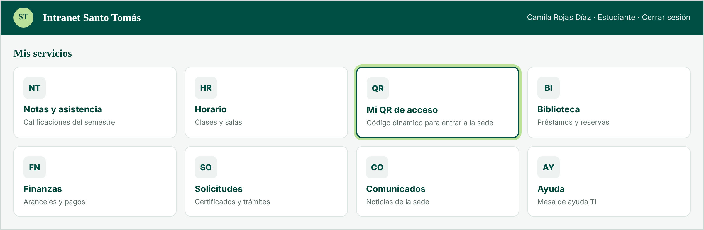

# QRonos · Control de acceso con QR dinámico

Proyecto **PRY-QRONOS-2026-01** · Zentra Core · IP Santo Tomás La Serena, Sede Ruta 5.

QRonos reemplaza la revisión manual de credenciales en los accesos de la sede. Cada persona autorizada (estudiante, profesor o auxiliar) muestra en su celular un código QR que cambia cada 60 segundos. El lector valida el código contra la lista de personas autorizadas y registra la entrada o la salida.



## Contenido del repositorio

| Entregable | Archivo |
|---|---|
| 1. Manual de Instalación / Despliegue | [docs/Manual_Instalacion_Despliegue.md](docs/Manual_Instalacion_Despliegue.md) · [versión Word](docs/word/Manual_Instalacion_Despliegue_QRonos.docx) |
| 2. Manual de Usuario | [docs/Manual_Usuario.md](docs/Manual_Usuario.md) · [versión Word](docs/word/Manual_Usuario_QRonos.docx) |
| Prototipo funcional | [prototipo/](prototipo/) (instrucciones en [prototipo/README.md](prototipo/README.md)) |

```
├── README.md                  ← este archivo
├── docs/
│   ├── Manual_Instalacion_Despliegue.md
│   ├── Manual_Usuario.md
│   ├── word/                  ← los dos manuales en Word
│   ├── img/                   ← ilustraciones del Manual de Usuario
│   └── anexos_instalacion/    ← archivos de configuración que usa el Manual de Instalación
└── prototipo/                 ← código: servidor Node.js, páginas web y base de datos
```

## Probar el prototipo en 5 pasos

Requisitos: XAMPP (MySQL), Node.js LTS y Chrome o Edge.

1. Abre XAMPP y pulsa **Start** en **MySQL**.
2. Importa `prototipo/schema.sql` en phpMyAdmin (`http://localhost/phpmyadmin`, pestaña **Importar**).
3. En una consola dentro de `prototipo/`: `npm install` y después `node server.js`.
4. Abre `http://localhost:3000`, ve a **Personas** e importa `ejemplo_personas.csv`.
5. Abre `http://localhost:3000/movil.html`, entra con un RUT del CSV y muestra el QR a la cámara.

El detalle completo está en [prototipo/README.md](prototipo/README.md).

## Equipo

| Integrante | Rol |
|---|---|
| Bruno Guajardo | Director del proyecto y Scrum Master |
| Reinaldo Castillo | Product Owner |
| Vicente Pereira | Dev Lead |
| Renato Cornejo | Infra Lead |
| Benjamín Rodríguez | Ops Lead |
