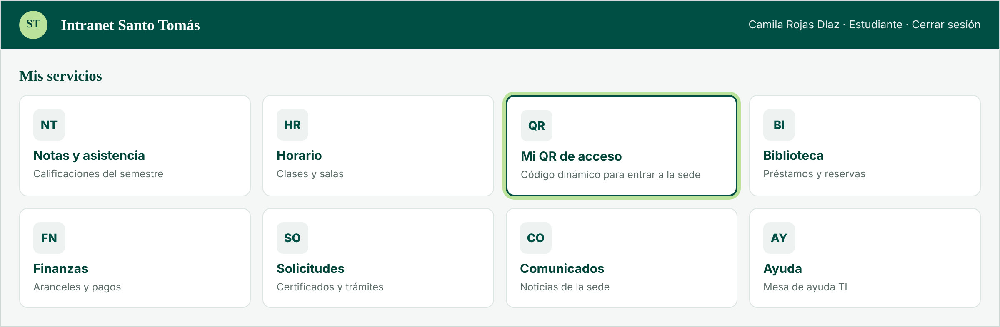
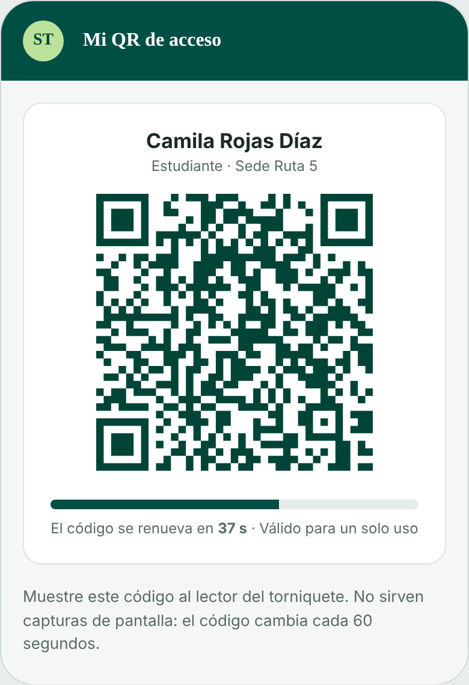
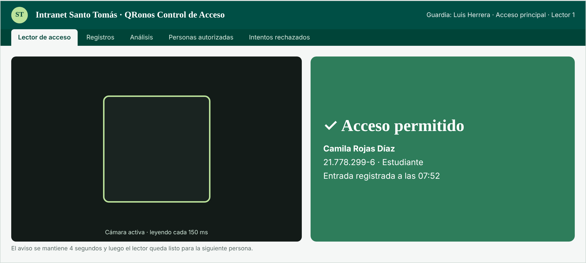
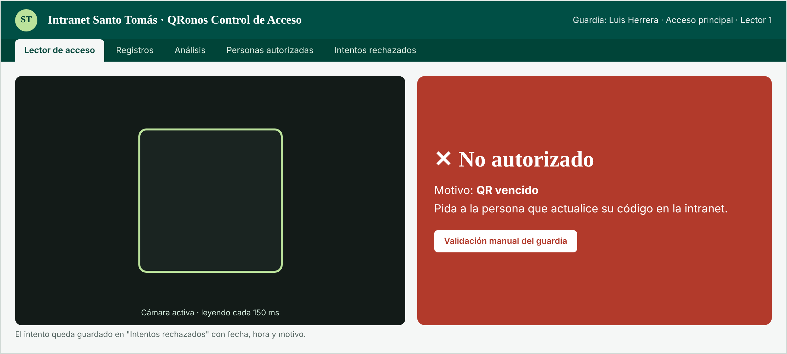
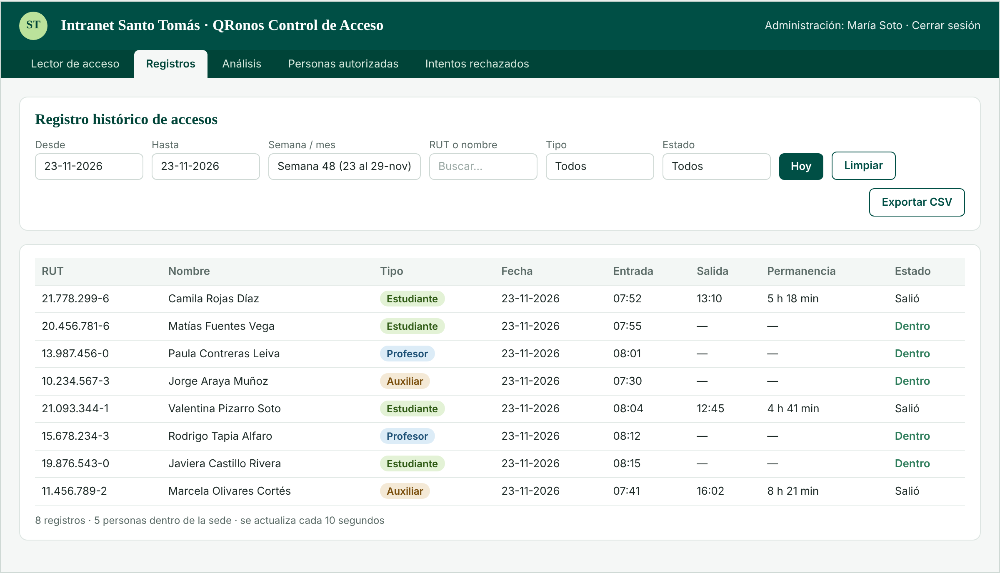
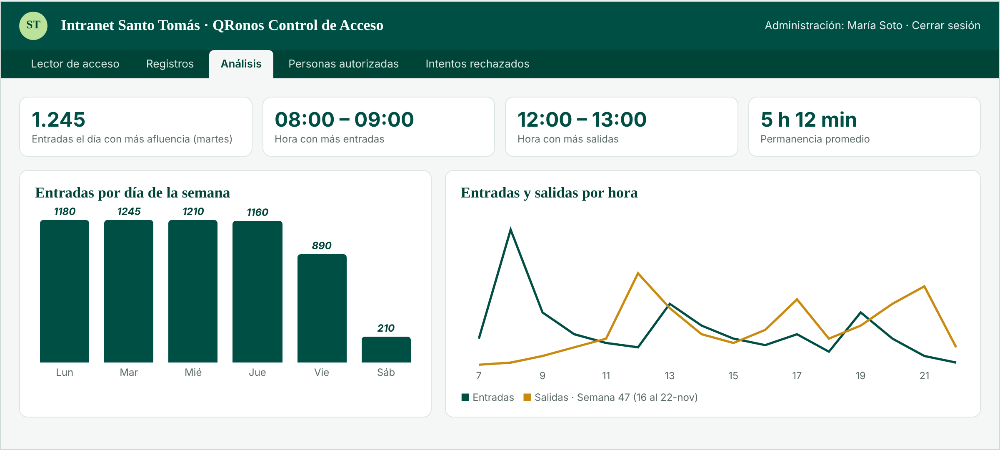
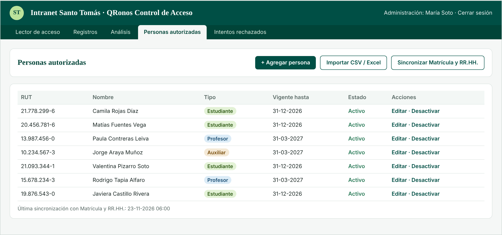
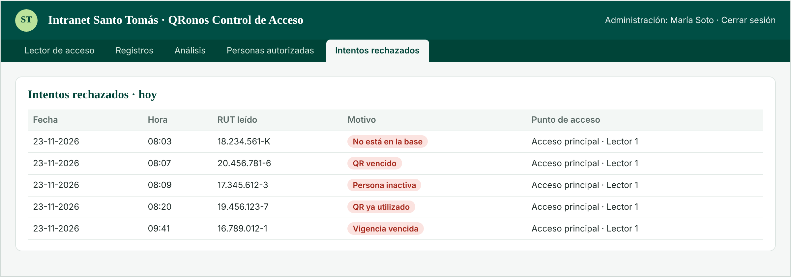

# Manual de Usuario · QRonos

Guía ilustrada para usar el control de acceso QRonos desde la intranet de la institución.

> Las imágenes son referenciales y usan datos ficticios.

## Índice

1. ¿Qué es QRonos?
2. Perfiles de uso
3. Para la comunidad: entrar a la sede con Mi QR
4. Para guardias: usar el lector de acceso
5. Para Administración: registros de accesos
6. Para Administración: análisis de datos
7. Para Administración: personas autorizadas
8. Para Administración: intentos rechazados
9. Preguntas frecuentes

---

## 1. ¿Qué es QRonos?

QRonos es el sistema de control de acceso de la Sede Ruta 5. Reemplaza la revisión manual de credenciales por un **código QR dinámico** que cada persona genera en la intranet. El código:

- cambia cada **60 segundos**;
- sirve **una sola vez**;
- solo se genera para personas **autorizadas y vigentes**.

Por eso no sirven capturas de pantalla ni fotos de la credencial.

---

## 2. Perfiles de uso

| Perfil | Quiénes | Qué puede hacer |
|---|---|---|
| Comunidad | Estudiantes, profesores y auxiliares | Generar su QR y entrar o salir de la sede |
| Guardia | Personal de seguridad | Operar el lector, ver el resultado de cada lectura y validar a mano en contingencias |
| Administración | Dirección de sede o Administración | Consultar registros, ver análisis, gestionar personas autorizadas y revisar rechazos |

Todos entran con su **usuario y clave de la intranet**. No hay que crear otra cuenta.

---

## 3. Para la comunidad: entrar a la sede con Mi QR

### Paso 1. Abrir la intranet

Entra a la intranet desde el navegador de tu celular e inicia sesión con tu cuenta institucional. En **Mis servicios**, toca **Mi QR de acceso**.

*Figura 1. Portal de la intranet: el módulo "Mi QR de acceso" aparece junto a los demás servicios.*

> **Consejo:** agrega la página a la pantalla de inicio de tu celular (en el menú del navegador, "Agregar a pantalla de inicio") para abrirla con un toque.

### Paso 2. Mostrar el código en el acceso

Aparece tu nombre, tu tipo (Estudiante, Profesor o Auxiliar) y el código QR. La barra inferior indica cuánto falta para que el código se renueve.

*Figura 2. Pantalla "Mi QR de acceso": el código se renueva solo cada 60 segundos.*

1. Al llegar al torniquete, acerca la pantalla del celular a la cámara del lector, a unos 15 o 20 cm.
2. Espera el aviso verde **Acceso permitido** y pasa.
3. Al salir, repite lo mismo: el sistema registra tu salida.

### Recomendaciones

- Sube el brillo de la pantalla para que el lector lo lea más rápido.
- Abre Mi QR **antes** de llegar a la fila.
- No compartas tu código: es personal y queda asociado a tu RUT.
- Si el código no aparece y ves el mensaje "No estás en la lista de personas autorizadas", acude a Administración de la sede.

---

## 4. Para guardias: usar el lector de acceso

### 4.1 Iniciar el lector

1. Enciende el equipo del acceso. El navegador abre la página **Lector de acceso** automáticamente.
2. Si lo pide, inicia sesión con tu cuenta de la intranet.
3. Revisa que arriba aparezcan tu nombre y el punto de acceso (por ejemplo, "Acceso principal · Lector 1").
4. Revisa que el recuadro de la cámara esté activo.

### 4.2 Acceso permitido

Cuando la persona muestra un QR válido, la pantalla se pone **verde** con su nombre, RUT, tipo y la hora registrada. El torniquete se abre solo.

*Figura 3. Lector de acceso: resultado "Acceso permitido".*

### 4.3 No autorizado

Si el código no es válido, la pantalla se pone **roja** y muestra el motivo. El torniquete no se abre.

*Figura 4. Lector de acceso: resultado "No autorizado" con su motivo.*

| Motivo | Qué significa | Qué hacer |
|---|---|---|
| QR vencido | Pasaron más de 60 segundos o es una captura | Pedir que abra Mi QR de nuevo |
| QR ya utilizado | El código ya se usó | Pedir un código nuevo |
| No está en la base | La persona no figura como autorizada | Derivar a Administración |
| Persona inactiva | Su registro está desactivado | Derivar a Administración |
| Vigencia vencida | Terminó su matrícula o contrato | Derivar a Administración |

### 4.4 Validación manual (contingencia)

Úsala solo cuando la persona **sí está autorizada** pero no puede mostrar su QR (celular sin batería, sin internet, o falla del lector):

1. Pulsa **Validación manual del guardia**.
2. Pide la cédula de identidad y escribe el RUT.
3. El sistema consulta la base y muestra nombre, tipo y vigencia.
4. Si está vigente, pulsa **Permitir acceso**. Queda registrado como acceso manual, con tu nombre.

**Visitas externas:** usa la misma opción y elige **Visita con pase temporal**. Registra el nombre, el RUT y el motivo de la visita.

> Si se corta la luz o la red, el lector muestra el aviso **Modo contingencia**. Usa la validación manual hasta que vuelva el servicio y avisa a la mesa de ayuda TI.

---

## 5. Para Administración: registros de accesos

En **Registros** se consulta el historial completo de entradas y salidas.

*Figura 5. Registro histórico de accesos con filtros y exportación.*

### Filtrar

| Filtro | Uso |
|---|---|
| Desde / Hasta | Rango de fechas (por defecto, hoy) |
| Semana / mes | Selecciona una semana (de lunes a domingo) o un mes completo |
| RUT o nombre | Busca a una persona |
| Tipo | Estudiante, Profesor o Auxiliar |
| Estado | "Dentro" (no ha marcado salida) o "Salió" |

- **Hoy** vuelve a la fecha actual.
- **Limpiar** quita todos los filtros.
- La tabla se actualiza sola cada 10 segundos. Abajo se ve cuántas personas siguen dentro de la sede.

### Exportar

Pulsa **Exportar CSV**. El archivo trae los mismos filtros que la pantalla y se abre directo en Excel.

> Los registros no se pueden editar ni borrar desde la pantalla. Así se conserva un historial confiable.

---

## 6. Para Administración: análisis de datos

En **Análisis** se ven los patrones de uso de la sede.

*Figura 6. Panel de análisis: afluencia por día y por hora.*

| Indicador o gráfico | Responde a |
|---|---|
| Entradas del día con más afluencia | ¿Qué día viene más gente? |
| Hora con más entradas | ¿A qué hora se forma la fila? |
| Hora con más salidas | ¿Cuándo se van las personas? |
| Permanencia promedio | ¿Cuánto tiempo pasa la gente en la sede? |
| Entradas por día de la semana | Comparación de lunes a sábado |
| Entradas y salidas por hora | Horas punta del día |

Los gráficos respetan los filtros de fecha, semana, mes y tipo. Sirven para decidir, por ejemplo, cuántos guardias asignar a las 08:00 o cuándo abrir un segundo acceso.

---

## 7. Para Administración: personas autorizadas

Solo las personas de esta lista pueden generar su QR y entrar.

*Figura 7. Personas autorizadas, con importación y sincronización.*

### Agregar a una persona

1. Pulsa **+ Agregar persona**.
2. Escribe el RUT (el sistema valida el dígito verificador), el nombre, el tipo y la fecha de vigencia.
3. Pulsa **Guardar**.

### Editar o desactivar

- **Editar:** cambia el nombre, el tipo o la vigencia.
- **Desactivar:** la persona deja de poder entrar, pero **su historial se conserva**.

### Importar una lista

1. Pulsa **Importar CSV / Excel**.
2. Sube un archivo con las columnas `rut;nombre;tipo;vigencia_hasta`.
3. Revisa el resumen de filas agregadas, actualizadas y con error.

### Sincronizar con Matrícula y RR.HH.

La lista se actualiza sola cada mañana. Si hubo una matrícula o una contratación nueva hoy, pulsa **Sincronizar Matrícula y RR.HH.** para actualizarla al momento.

---

## 8. Para Administración: intentos rechazados

En **Intentos rechazados** se ve cada lectura que no fue aceptada, con fecha, hora, RUT leído, motivo y punto de acceso.

*Figura 8. Lista de intentos rechazados del día.*

Sirve para:

- detectar intentos de entrar con capturas o códigos ajenos;
- encontrar personas vigentes que faltan en la base;
- revisar si un lector está fallando más de lo normal.

---

## 9. Preguntas frecuentes

**¿Necesito instalar una aplicación?**
No. Mi QR funciona desde el navegador del celular, dentro de la intranet.

**¿Puedo usar una captura de pantalla del QR?**
No. El código vence en 60 segundos y sirve una sola vez.

**¿Qué pasa si no tengo internet en el celular?**
Pide al guardia la validación manual con tu cédula de identidad.

**Mi QR dice que no estoy autorizado y estoy matriculado.**
Puede que tu matrícula aún no se haya sincronizado. Acude a Administración de la sede.

**¿Qué datos míos guarda el sistema?**
Solo tu RUT, nombre, tipo, vigencia y las horas de entrada y salida, según las Leyes N.º 19.628 y 21.719. Solo la Administración puede consultarlos.

**¿A quién aviso si el lector no funciona?**
A la mesa de ayuda TI de la sede.
